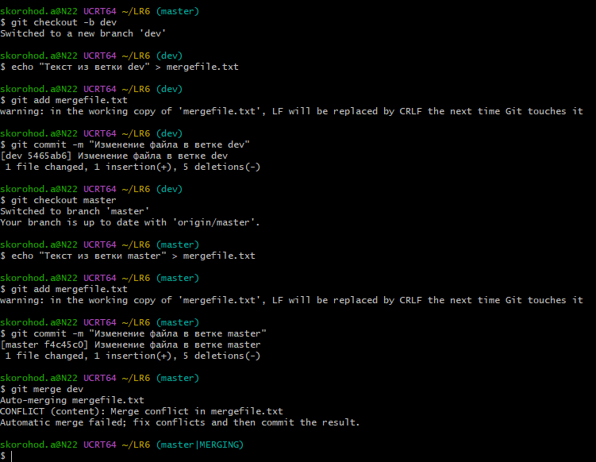
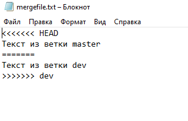
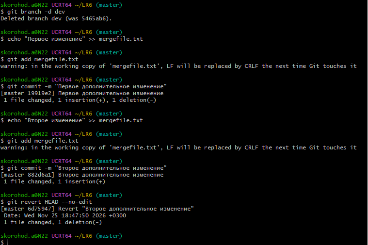

# Лабораторная работа №6. Система контроля версий Git

**Выполнил:** Студент группы 4541в Скороход А.А.  
**Вариант:** 22

## Цель работы
Изучение базовых возможностей системы управления версий, получение опыта работы с Git API, локальным и удалённым репозиториями.

---

## Ход выполнения работы

### 1. Подготовка репозитория и работа с ветками
Создан форк исходного репозитория `Kurtyanik/LR6`, настроены имя пользователя и email, выполнено клонирование на локальный компьютер. Через веб-интерфейс GitHub добавлен файл `teeest11` и синхронизирован с локальной копией. Просмотрены история веток и последние изменения.

### 2. Слияние веток и разрешение конфликта
Создана побочная ветка `dev`, внесены конфликтующие изменения в файл `mergefile.txt` в ветках `dev` и `master`. При попытке слияния возник конфликт, который был разрешён вручную в текстовом редакторе с последующей фиксацией результата.




### 3. Удаление ветки, серия коммитов и откат изменений
После успешного слияния побочная ветка `dev` удалена. Выполнено несколько последовательных коммитов с комментариями, после чего произведён откат последнего изменения с помощью `git revert`.



---

## Лог использованных команд

```bash
git config --global user.name "4541в Скороход А.А."
git config --global user.email "arturskorokhod99@gmail.com"
git clone https://github.com
cd LR6
git pull origin master
git branch -a
git log -p
mkdir screenshots
git checkout -b dev
echo "Текст из ветки dev" > mergefile.txt
git add mergefile.txt
git commit -m "Изменение файла в ветке dev"
git checkout master
echo "Текст из ветки master" > mergefile.txt
git add mergefile.txt
git commit -m "Изменение файла в ветке master"
git merge dev
notepad mergefile.txt
git add mergefile.txt
git commit -m "Разрешен конфликт в mergefile.txt"
git branch -d dev
echo "Первое изменение" >> mergefile.txt
git add mergefile.txt
git commit -m "Первое дополнительное изменение"
echo "Второе изменение" >> mergefile.txt
git add mergefile.txt
git commit -m "Второе дополнительное изменение"
git revert HEAD --no-edit
git checkout -b report
git log --pretty=format:"%h | %ad | %an | %s" --date=short
```

---

## История операций (Вариант 22)
Формат: *сокращённый хэш + дата + имя автора + комментарий*.

```text
6d75947 | 2026-11-25 | 4541в Скороход А.А. | Revert "Второе дополнительное изменение"
882d6a1 | 2026-11-25 | 4541в Скороход А.А. | Второе дополнительное изменение
19919e2 | 2026-11-25 | 4541в Скороход А.А. | Первое дополнительное изменение
fccca07 | 2026-11-25 | 4541в Скороход А.А. | Разрешен конфликт в mergefile.txt
f4c45c0 | 2026-11-25 | 4541в Скороход А.А. | Изменение файла в ветке master
5465ab6 | 2026-11-25 | 4541в Скороход А.А. | Изменение файла в ветке dev
7f13dad | 2026-11-25 | wruuumRU | Create teeest11
921f53b | 2020-11-21 | Kurtyanik | Обновление информации
c08a654 | 2020-11-21 | Kurtyanik | Файл создан пустым
3c6e913 | 2020-11-21 | Kurtyanik | Initial commit
```
